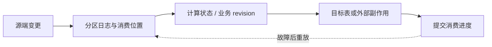

# 湖仓与流处理工程更新 · 2026-11-17

> 面向 L2–L4 的补充阅读；课程阶段和项目编号继续以 `curriculum.yaml`、`project_catalog.json` 为准。
> 官方资料检索：2026-11-17。下面是版本与工程机制的更新，不代表这些组件已作为一套集群联合验证。

## 1. 已核验的发布锚点

| 组件 | 发布锚点 | 值得学习的变化与核对事项 |
|---|---|---|
| Spark | 4.3.0，2026-10-30 | Real-Time Mode 的有状态处理、Declarative Pipelines 的 SCD Type 2 Auto CDC；实验特性和具体限制以发布页为准 |
| Flink | 2.3.0，2026-06-25 | SQL changelog 转换、物化表刷新策略、应用生命周期管理；原生 S3 文件系统仍标为实验性 |
| Kafka | 4.4.0，2026-10-22 | 客户端 / broker 升级说明及配置废弃项；不要把 broker 版本升级等同于外部数据库的事务升级 |
| Iceberg | 1.12.0，2026-09-29 | 按 Spark / Flink 版本选择 runtime JAR；本版移除 Spark 3.4、Flink 2.0 支持 |
| Flink CDC | 3.7.0，2026-10-10 | 独立版本线，先核对连接器与 Flink、源端数据库、目标表的支持矩阵 |

来源：[Spark 发布与日期](https://spark.apache.org/news/)、[Spark 4.3.0](https://spark.apache.org/releases/spark-release-4-3-0.html)、[Flink 2.3.0](https://flink.apache.org/2026/06/25/apache-flink-2.3.0-release-announcement/)、[Kafka 4.4.0](https://kafka.apache.org/blog/2026/10/22/apache-kafka-4.4.0-release-announcement/)、[Iceberg Releases](https://iceberg.apache.org/releases/)、[Flink / CDC Downloads](https://flink.apache.org/downloads/)。

版本号不能直接拼成可运行组合。例如 Iceberg 当前发布页提供 Spark 4.0、4.1、3.5 对应的 runtime JAR，不能因为 Spark 已发布 4.3 就把 `spark-runtime-4.1` 当作已兼容 4.3。还要对齐 Scala、Java、catalog、对象存储和连接器依赖。

## 2. CDC 的四种顺序，先分清再写 SQL

| 顺序 / 状态 | 表达什么 | 常见误用 |
|---|---|---|
| 源数据库事务位置 | 原库中变更的先后 | 用采集机墙钟时间替代 |
| 日志分区与 offset | 消费位置与重放身份 | 把不同分区的 offset 直接比较大小 |
| 同一业务主键的 revision | 哪一版业务状态更新 | 用最后到达的消息覆盖最新业务状态 |
| 目标端已提交位置 | 哪些效果可在故障后恢复 | 状态写成功、进度没记；或先记进度再写状态 |

示例中，订单 revision=3 的“已支付”先到，revision=2 的“待支付”后到，后者仍是旧状态。删除后还要保留删除版本；否则迟到的旧 upsert 可能把已删除行重新写回来。

生产系统需定义比较键，例如数据库日志位置与事件序号的组合；不能直接假定所有数据库都有一个跨分区全局递增的整数版本。本课程实验显式要求输入已经提供**同一主键可比较的 revision**。

## 3. Exactly-once 的边界画在哪里？

Kafka 幂等生产、Kafka 事务、Flink checkpoint 与外部表提交分别解决不同边界的问题。目标端是外部数据库、HTTP 服务或对象存储时，必须另外确认提交协议或幂等机制；“开启 checkpoint”本身无法覆盖所有外部副作用。[Kafka 消息交付语义](https://kafka.apache.org/44/design/design/#semantics)



检查一个方案时，逐项回答：

1. 重放身份由什么组成，是否包含流 / topic 与分区？
2. 相同身份、不同内容是否会被检测，而不是静默丢弃？
3. 业务状态和消费位置能否在一个恢复协议里提交？
4. 删除墓碑、重放日志和 checkpoint 各保留多久，何时能安全清理？
5. 发邮件、扣费等外部操作是否有自己的幂等键或 outbox？

## 4. 湖仓治理：一次成功写入之后还有工作

湖仓不只是“Parquet 加目录”。还要维护可见快照、并发提交、schema / partition 演进、小文件、删除文件及保留策略。Catalog 协议解决元数据访问，不自动保证所有引擎都能读写所有表格式版本和特性。[Iceberg 概念与维护入口](https://iceberg.apache.org/docs/latest/)

设计 CDC 落湖时，把正确性与维护指标放在同一份验收报告：

| 维度 | 至少记录 |
|---|---|
| 正确性 | 重放后主键唯一、最新 revision、删除是否复活、故障恢复是否漏事件 |
| 时效性 | 源端变更到目标可查询的延迟分布、积压增长率 |
| 维护 | 每次提交文件数、小文件比例、压缩 / 合并与快照清理耗时 |
| 兼容性 | 引擎、connector、runtime JAR、catalog、表格式与依赖版本 |
| 成本 | 写入、合并、查询与存储分别计量，不能只比较计算任务耗时 |

Watermark 表达事件时间进展及相关迟到处理策略，不能替代主键版本比较，也不是“消息绝不会再来”的承诺。

## 5. 动手：重复、迟到删除与故障回滚

新增 [CDC 重放实验](labs/l3-cdc-replay/README.md)，仅使用 Python 标准库与 SQLite，无需安装 Kafka / Flink / Spark。它在同一数据库事务里写入业务状态、接收记录与分区进度，用测试验证恢复约定。

从 `big_data` 目录执行：

```bash
python labs/l3-cdc-replay/replay_cdc.py labs/l3-cdc-replay/data/events.jsonl.sample --database labs/l3-cdc-replay/output/cdc.db --output labs/l3-cdc-replay/output/report.json
python -m unittest discover -s labs/l3-cdc-replay -p "test_*.py"
```

实验实现的是最新状态表，不包含 SCD Type 2 历史区间、真实日志采集或分布式两阶段提交。迁移到集群时，须重新验证目标连接器的事务与恢复能力。

## 6. 学完应能回答

- 为什么 revision=2 晚于 revision=3 到达时不能覆盖状态？
- 为什么物理删除目标行可能让旧 upsert 将其复活？
- 为什么相同分区 offset 对应不同内容应立即失败？
- 为什么源位置允许有空洞，但不能把不同分区的 offset 排成全局业务顺序？
- 为什么“Spark、Iceberg 都是最新版”仍可能找不到兼容的 runtime JAR？
