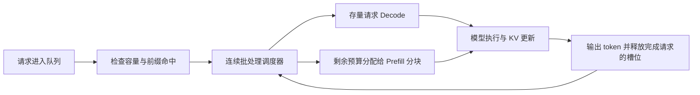

# 推理服务与调度：把吞吐变成满足延迟目标的请求

> 更新与官方资料检索：2026-11-17。对应技术地图第 1、2 类。
> 前置：[缓存与上下文复用](01-缓存与上下文复用.md)、[高命中率实战](02-高命中率实战.md)。
> vLLM 命令依据检索日官方文档，需在支持的 Linux / WSL2 与 GPU 环境中运行；本文未实测服务压测命令。

## 1. 问题：吞吐更高，为什么体验更差？

假设两种配置都运行 60 秒，各收到 1,000 个请求：A 完成 900 个，其中 540 个满足全部延迟目标；B 完成 840 个，其中 756 个满足目标。A 的完成吞吐是 15 req/s，B 是 14 req/s；但 B 的 **goodput 是 12.6 req/s，超过 A 的 9 req/s**。这是用于说明定义的假设数据。

| 指标 | 定义与单位 | 容易混淆之处 |
|---|---|---|
| TTFT | 请求发出至首个输出 token，ms | 包含客户端可见的排队、网络和 Prefill 等开销 |
| TPOT | `(端到端耗时 - TTFT) / (输出 token 数 - 1)`，ms/token | 请求内的平均值；单 token 输出需单独约定，vLLM 按 0 处理 |
| ITL | 相邻流式输出事件的时间间隔，ms | 一次事件可带多个 token；其 p99 不等于 TPOT p99 |
| 完成吞吐 | 成功完成请求数 / 测量时长，req/s | 还需报告失败、超时和拒绝数 |
| Goodput | 满足全部指定 SLO 的成功请求数 / 测量时长，req/s | **不是百分比**；满足 SLO 的请求比例应另报 |

Goodput 的定义来自 [DistServe 作者说明](https://haoailab.com/blogs/distserve/)；TPOT 和 ITL 的统计口径见 [vLLM Metrics](https://docs.vllm.ai/en/stable/design/metrics/)。比较结果时还要固定输入、输出长度分布与到达率。

## 2. 原理：每轮决定哪些 token 能上 GPU

Prefill 通常有较高的计算强度；低并发 Decode 往往更受权重和 KV 读取带宽限制。具体瓶颈随 batch、上下文长度、模型及硬件变化，不能给所有场景套同一个资源画像。



连续批处理在**迭代边界**补入和移除请求，不必等待最慢请求结束。分块 Prefill 则让一个长输入分多轮进入执行批次。vLLM V1 在可用时默认启用分块 Prefill，并优先安排 Decode，再把剩余 token 预算分给 Prefill。[官方调优说明](https://docs.vllm.ai/en/stable/configuration/optimization/)

下面是教学伪代码；省略了显存分页、抢占、多模态和分布式约束：

```python
while waiting or running:
    budget = max_num_batched_tokens
    batch = admit_decode(running, token_budget=budget)
    budget -= scheduled_tokens(batch)
    batch += admit_prefill_chunks(waiting, token_budget=budget)
    execute_model(batch)
    emit_tokens_and_release_finished_requests()
```

`max_num_seqs` 限制活跃序列数量；`max_num_batched_tokens` 限制单轮安排的 token 工作量；`max_model_len` 约束单序列长度。三者不能互相代替。投机解码、多模态或其他调度路径下，也不能假定每个序列每轮恰好占一个 token。[Engine Arguments](https://docs.vllm.ai/en/latest/configuration/engine_args/)

## 3. 工程：先建立一个可比较的单副本基线

先记录 Python、PyTorch、vLLM、GPU/驱动版本、模型和 tokenizer 的 revision、chat template、采样参数及启动命令。`stable` 和 `latest` 文档会变化，复现实验时保存所用软件版本与命令输出。

以下 Bash 示例选择规模较小的模型，首次运行需要下载权重。示例参数用于建立基线，不代表最优配置：

```bash
python -c "import torch, vllm; print('torch', torch.__version__, 'vllm', vllm.__version__)"
vllm serve --help
vllm bench serve --help

vllm serve Qwen/Qwen3-0.6B \
  --host 127.0.0.1 --port 8000 \
  --max-model-len 8192 \
  --max-num-seqs 32 \
  --max-num-batched-tokens 2048 \
  --enable-chunked-prefill \
  --enable-prefix-caching
```

在另一个终端执行基线压测：

```bash
vllm bench serve \
  --backend vllm \
  --base-url http://127.0.0.1:8000 \
  --model Qwen/Qwen3-0.6B \
  --dataset-name random \
  --random-input-len 1024 --random-output-len 128 \
  --request-rate 2 --num-prompts 200 --seed 42 \
  --ignore-eos \
  --percentile-metrics ttft,tpot,itl,e2el \
  --metric-percentiles 50,95,99 \
  --goodput ttft:1000 tpot:50 \
  --save-result --result-dir bench-results
```

此处 SLO 是教学示例。随机输入适合容量比较，不能检验业务质量或真实前缀复用；`--ignore-eos` 用于控制输出工作量，真实流量评测还需保留自然结束行为。200 个请求只适合冒烟，稳定估计 p99 需要更多样本和重复实验。到达率依次取 1、2、4、8 req/s，观察队列是否持续增长；默认 `request-rate=inf` 是突发负载，不能作为日常流量的替代。[压测参数说明](https://docs.vllm.ai/en/latest/cli/bench/serve/)

建议实验顺序：固定模型与流量，先调整单轮 token 预算，再调整最大活跃序列，最后加入缓存、投机或多实例架构。每一步都同时保留 goodput、延迟分位数和错误率。

## 4. 什么时候该做 PD 分离？

PD 分离把 Prefill 与 Decode 放在不同实例，通过 connector 传递 KV，让两边独立选择并行与容量配置。vLLM 当前文档仍将该功能标为**实验性**，主要目标是分别控制 TTFT 与尾部 ITL；不能据此推断任意部署的总吞吐都会提高。[vLLM Disaggregated Prefilling](https://docs.vllm.ai/en/latest/features/disagg_prefill/)

先估算一次传输的成本。对常规 MHA/GQA、未分片且未压缩的 KV：

```text
KV 字节数 ≈ 2 × 层数 × KV 头数 × head_dim × token 数 × 每元素字节数
传输耗时下界 = 实际传输字节数 / 有效链路带宽
```

例如 32 层、8 个 KV 头、head_dim=128、BF16、8,192 token，KV 约 1 GiB。若有效带宽是 25 GB/s，纯传输下界约 43 ms，尚未计入排队、协议、复制与同步。张量分片、量化、共享前缀和 MLA 会改变实际传输量。

工程决策应比较“减少的干扰与排队”能否覆盖“传输、额外容量和运维”成本，不能按固定 GPU 卡数判断拐点。已有可测的混部尾延迟问题，并具备可靠的 KV 传输、故障恢复与版本兼容方案时，再评估拆分。

## 5. 投机解码：接受率高也可能变慢

草稿生成多个候选，目标模型批量验证。判断是否值得启用，要比较一轮成本：

```text
投机模式的平均每 token 成本 ≈ (草稿耗时 + 验证耗时 + 调度开销) / 平均实际前进 token 数
```

因此除了接受率，还要测每轮前进长度、草稿模型显存、目标模型验证成本和不同并发下的 goodput。高并发时，验证工作量可能挤占已有效批处理的 Decode。

当前 vLLM 文档列出 n-gram、EAGLE3、MTP 等路径；参数集中在 `--speculative-config`。标准拒绝采样以保持目标分布为目标，但浮点与批次变化不保证逐字输出相同；**FLy 放宽验证，不保持原始分布**，不能沿用标准拒绝采样的无损结论。[Speculative Decoding，检索页更新日期 2026-11-11](https://docs.vllm.ai/en/stable/features/speculative_decoding/)

选择路线时先确认模型和引擎版本是否支持，再固定采样设置，对比关闭投机的基线。不要把论文的加速比直接填进容量规划。

## 6. 系统实践：用公开实现判断适用范围

| 系统 / 官方材料 | 已有机制 | 评估时关注 |
|---|---|---|
| [vLLM 调优文档](https://docs.vllm.ai/en/stable/configuration/optimization/) | 连续批处理、分块 Prefill、并行策略 | 单轮预算与 TTFT / ITL 的权衡 |
| [SGLang PD 文档](https://docs.sglang.io/docs/advanced_features/pd_disaggregation) | Prefill / Decode 拆分与传输后端配置 | 路由、网络拓扑、连接器和运行版本 |
| [DistServe 作者说明](https://haoailab.com/blogs/distserve/) | 将满足 SLO 的吞吐作为优化目标 | 实验的延迟目标、模型、卡数和流量分布 |

这些材料证明相应机制有公开实现或评估；其示例结果不能代表本仓库环境的实测收益。

## 7. 看板与反模式

先查看实际部署的 `/metrics`，再写查询。当前 vLLM 文档使用 `vllm:kv_cache_usage_perc`、`vllm:prefix_cache_queries`、`vllm:prefix_cache_hits` 等；旧版的 `gpu_...` 指标名不应直接照搬。缓存比例可以由同一时间窗口内 hits / queries 的增量计算；需核对所用版本的计数单位和标签维度。[Metrics](https://docs.vllm.ai/en/stable/design/metrics/)

| 反模式 | 更合适的做法 |
|---|---|
| 只报告 tokens/s | 同时报告 goodput、TTFT、TPOT、ITL、失败与拒绝数 |
| 把所有开关一起打开 | 每轮只变一组参数，保留基线与配置 |
| 以请求数代替缓存 token 复用率 | 明确分母与 token / block 等计数单位 |
| 缓存亲和优先到让热点副本过载 | 把队列和容量纳入路由成本，设置负载上界 |
| 在不同输入输出长度下比较配置 | 固定工作负载，并对长短请求分别统计 |
| 把微型算子计时称作服务 TTFT | 用流式端到端压测获取用户可见延迟 |

## 8. 自测

<details>
<summary>1. 60 秒完成 900 个请求，只有 600 个满足全部 SLO，goodput 是多少？</summary>

10 req/s。600/900 是成功请求中的 SLO 达标比例，属于另一个指标。
</details>

<details>
<summary>2. 降低单轮 token 预算后 ITL 改善、TTFT 变差，为什么？</summary>

单轮 Prefill 对 Decode 的干扰可能减小，但长输入需要更多轮才能完成 Prefill；是否采用仍需看流量下的 goodput。
</details>

<details>
<summary>3. 为什么投机模式下 TPOT 与 ITL 更不能混用？</summary>

一轮验证可能输出多个 token。流式事件间隔与请求内平均每 token 时间的采样单位不同，尾部分位数也不同。
</details>

<details>
<summary>4. 编译后的 attention 前向耗时减半，端到端 TTFT 会减半吗？</summary>

无法直接推导。TTFT 还包含排队、tokenization、其他网络层、数据传输等；需用相同负载验证整个服务。
</details>

继续阅读：[PyTorch 2.15 与大模型工程](04-PyTorch2.15与大模型工程.md)，或运行 [Serving 引擎内部实验](../ml_train/09_inference_optimization/12_serving_engine_internals.ipynb)。
