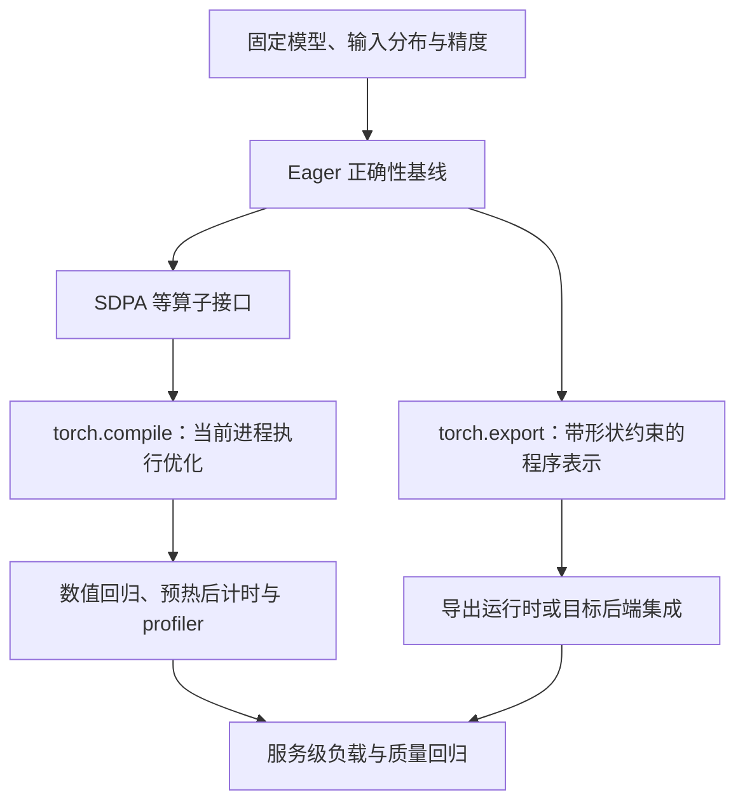

# PyTorch 2.15 与大模型工程：从版本更新到可验证的优化

> 更新与官方资料检索：2026-11-17。发布锚点为 **PyTorch 2.15（2026-10-28）**。
> 配套：[现代 PyTorch 推理实验](../ml_train/09_inference_optimization/13_modern_pytorch_inference.ipynb)。
> Notebook 使用 PyTorch 2.6+ 已有 API；2.15 专属通信与硬件能力在本文说明，需对应环境另外验证。

## 1. 这轮发布，哪些变化值得跟进？

| 2.15 官方发布变化 | 工程上先检查什么 |
|---|---|
| 重写的 NCCL 后端成为默认，提供故障记录与旧后端回退路径 | 分布式作业启动、超时诊断与回退 |
| FSDP2 / 流水并行细化精度、内存与通信控制 | 梯度 dtype、累积与恢复结果；相关 API 标为不稳定 |
| 新增基于 NIXL 的单边传输 API | 网络、依赖与适用范围；API 标为不稳定 |
| Blackwell NVFP4 Decode 与 Apple Silicon 内核改进 | 实际硬件、模型形状和量化路径是否匹配 |
| Python 3.11–3.15；MPS 加速要求 macOS 15+ | Python、系统及配套包兼容性 |

来源：[PyTorch 2.15 Release Blog](https://pytorch.org/blog/pytorch-2-15-release-blog/)。版本发布不等于所有路径都能在任意设备运行。升级评估要保留工作负载、精度和环境记录。

## 2. 问题：优化一层，为什么整个系统不快？

假设模型前向占端到端耗时的 60%，并把这部分加速到原来的 2 倍，总加速上限也只有 `1 / (0.4 + 0.6 / 2) ≈ 1.43` 倍。这是 Amdahl 定律的示例计算，不是本机测量值。

先区分下面几项工作，再决定用哪个工具：



简化工作流：

```python
reference = eager_model(example_inputs)
candidate = optimized_model(example_inputs)
assert_close(candidate, reference)       # 先检查行为
measure_first_call_and_warm_latency()     # 再拆开首次调用与稳态
evaluate_at_target_request_rate()         # 最后确认服务收益
```

## 3. `torch.compile`：捕获边界、形状与首次调用

`fullgraph=True` 要求调用可捕获为一个图，遇到无法捕获的部分会报错，适合暴露图断裂。它不保证只有一个 GPU kernel。动态形状也不保证“只编译一次”，dtype、stride、控制流或其他 guard 变化仍可能触发重编译。[2.15 API](https://docs.pytorch.org/docs/2.15/generated/torch.compile.html)

```python
compiled = torch.compile(model, backend="inductor", fullgraph=True, dynamic=True)
with torch.inference_mode():
    reference = model(x)
    first = compiled(x)  # 包含首次捕获 / 编译等开销
    torch.testing.assert_close(first, reference, rtol=1e-4, atol=1e-5)
    for _ in range(5):
        compiled(x)     # 预热；异步设备计时需同步
```

对于重复 Transformer block，可评估 regional compilation 来缩小首次编译的图；它从 PyTorch 2.5 已有，**不是 2.15 新增**。官方 Diffusers 实践展示了这种折中，但实际收益依赖模型与缓存状态。[Regional compilation 教程](https://docs.pytorch.org/tutorials/recipes/regional_compilation.html)、[PyTorch / Diffusers 实践](https://pytorch.org/blog/torch-compile-and-diffusers-a-hands-on-guide-to-peak-performance/)

记录首次调用时，说明磁盘编译缓存是否已经存在。未经清理和隔离的首次调用不能称作纯冷编译时间。Notebook 使用当前进程的首次调用和预热后中位数，不声称测得了完全隔离的编译耗时。

Notebook 默认采用 `aot_eager` 教学后端验证捕获与结果一致性，不生成 Inductor 优化内核，不据此宣称融合加速。在具备编译器和相应 GPU 工具链的环境，可设置 `PYTORCH_TUTORIAL_BACKEND=inductor`。后端错误会直接暴露，不能用静默回退得到的 Eager 数据充当编译结果。

## 4. SDPA：正确的掩码比选快核更先

`scaled_dot_product_attention` 根据输入与环境选择可用实现，调用该 API 不等于强制使用 FlashAttention。推理时显式设置 `dropout_p=0.0`；布尔 mask 中 `True` 表示允许参与注意力，这与部分其他 attention API 的含义不同。

尤其注意 KV cache 的位置关系：

| 场景 | Q / K 长度 | 掩码 |
|---|---|---|
| 全序列因果 Prefill | `L == S` | 可使用 `is_causal=True` |
| 单 token Decode，KV 只含有效历史及当前 token | `L=1, S=历史长度+1` | 全部 K 都可见，可使用 `is_causal=False` |
| 分块 Decode / Prefill、含 padding 或预分配 KV | 非方阵 | 按绝对位置、有效长度和模型的窗口规则构造 mask |

SDPA 在非方阵下的 `is_causal=True` 使用**左上对齐**的因果掩码，不能直接当作“查询处在 KV 尾部”。配套实验对比完整因果前向与单步 / 分块结果，能发现这一类不会报错却会算错的错误。[2.15 SDPA API](https://docs.pytorch.org/docs/2.15/generated/torch.nn.functional.scaled_dot_product_attention.html)

## 5. `torch.export`：把形状范围变成交付约定

`torch.export.export` 产生包含图、参数和约束的 `ExportedProgram`，不会自动变成 vLLM 服务或通用二进制。目标运行时的算子、设备和 dtype 支持仍需验证。[Export 概览](https://docs.pytorch.org/docs/2.15/user_guide/torch_compiler/export.html)

```python
batch = torch.export.Dim("batch", min=1, max=8)
tokens = torch.export.Dim("tokens", min=2, max=128)
ep = torch.export.export(
    model,
    (example_x,),
    dynamic_shapes={"x": {0: batch, 1: tokens}},
)
runtime_model = ep.module()
```

示例假定模型入口名为 `x`，形状为 `[batch, tokens, hidden]`。契约中的上下界要通过边界输入验证，超出范围应拒绝；同时验证保存、加载后的结果。导出文件适合在明确版本与后端支持范围内交付。[Export API](https://docs.pytorch.org/docs/2.15/user_guide/torch_compiler/export/api_reference.html)

## 6. torchao：先选硬件与工作负载，再选位宽

torchao 当前使用配置类与 `quantize_` 组合，例如 `Int8WeightOnlyConfig`、`Int4WeightOnlyConfig`、`Float8DynamicActivationFloat8WeightConfig`。不同配置对设备、矩阵形状、group size 和 PyTorch 版本的要求不同；NVFP4 / MX 路径中还存在 prototype 工作流。

先用相同任务集保存 BF16/FP32 基线，验证量化误差、结构化输出与长上下文质量，再测预热后的延迟、显存及服务 goodput。减少权重字节并不保证减少延迟：量化、反量化、小矩阵和内核启动开销都可能抵消收益。[torchao Quantized Inference](https://docs.pytorch.org/ao/stable/workflows/inference.html)

实践前记录 `torch` / `torchao` 的兼容版本。硬件量化示例按需安装，不纳入这个无需下载模型的基础实验；端侧路线接着读 [torchao 工具链实验](../on_device_deployment/01_model_compression/1.6_torchao_toolchain.ipynb)。

## 7. 动手实验与验证范围

[13_modern_pytorch_inference.ipynb](../ml_train/09_inference_optimization/13_modern_pytorch_inference.ipynb) 包含：

1. 用小张量检查 SDPA 的因果 Prefill、单 token Decode 与带历史的分块注意力。
2. 比较小型投影网络的 Eager 与编译输出，分别报告首次调用和预热后延迟。
3. 在 CPU 上验证动态 batch / token 维度，检查上界越界与导出文件往返加载。
4. 计算理论 KV 占用，并说明与分配器实测显存的区别。

从仓库根目录执行：

```bash
python ml_train/scripts/validate_notebooks.py 09_inference_optimization/13_modern_pytorch_inference.ipynb --execute
```

默认自动选择 CUDA，否则使用 CPU；设置 `PYTORCH_TUTORIAL_DEVICE=cpu` 可强制 CPU。Notebook 的微型实验不包含 tokenizer、HTTP、请求队列与模型下载，其前向耗时不能当作生产 LLM 的 TTFT 或 tokens/s。

验证记录（2026-11-17）：Windows、Python 3.12.9、PyTorch 2.10.0+cu128，分别通过 CPU 与 NVIDIA GeForce RTX 5090 Laptop GPU 的完整 Jupyter 执行，编译后端为 `aot_eager`。检查覆盖数值一致性、多个动态形状、非法形状拒绝与导出文件往返。Inductor 性能、2.15 专属功能、量化和分布式服务均未在本次实验中实测。

## 8. 反模式与自测

| 反模式 | 验证方式 |
|---|---|
| 只升级 torch，不记录环境与精度 | 先保存基线配置、依赖版本和业务回归集 |
| 将 `aot_eager` 的结果写成 Inductor 加速 | 输出实际后端，区分图捕获与代码生成 |
| 将首轮编译混进稳态延迟 | 分开报告首次调用、预热次数及后续分布 |
| 假定 `eval()` 会关闭 SDPA 的 dropout | 在 SDPA 调用中明确传入 `dropout_p=0.0` |
| 只用导出时的形状测试 | 验证多个有效形状、范围边界和非法输入 |

<details>
<summary>1. `fullgraph=True` 是否意味着只有一次 kernel launch？</summary>

否。它约束图捕获边界，图中仍可能包含多个内核与库调用。
</details>

<details>
<summary>2. 为何单 token Decode 用 `is_causal=True` 可能得到错误结果？</summary>

非方阵掩码按左上对齐，长度为 1 的查询只能看到第一个 key；如果该查询实际处在序列末尾，就屏蔽了应可见的历史。
</details>

<details>
<summary>3. 动态导出范围为 batch 1–8，为什么还要测试 batch=9？</summary>

确认交付程序确实拒绝越界输入，避免调用方误以为动态维度可以无限增长。
</details>

<details>
<summary>4. 升级后出现更大的性能数字，可以直接归因于新版本吗？</summary>

只有硬件、模型、输入分布、精度、编译缓存、预热和服务负载等条件一致，才能比较版本影响；否则先排除配置差异。
</details>

服务级验证继续看 [推理服务与调度](03-推理服务与调度.md)。
